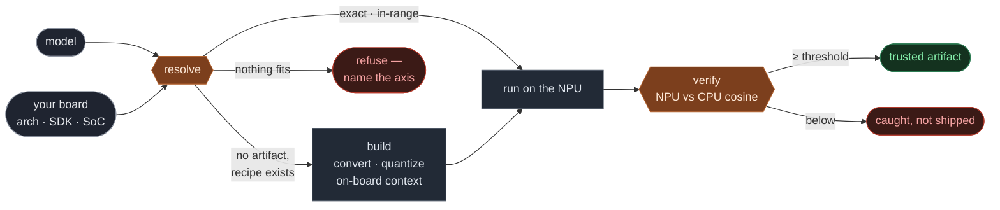

# Chipwright

[](https://www.python.org/)
[](LICENSE)
[](#tested-is-a-record-not-a-badge)

**A verified package manager and model hub for NPUs.** Chipwright reads your board, hands you an artifact that will actually load on your exact chip, and proves it against a CPU reference before you trust the output.

`resolve · run · build` — Qualcomm first, cross-vendor by design.



---

## The problem

On an NPU, a model isn't a file. It's a context binary pinned to a precise tuple: **architecture × SDK × quantization × shape × backend**. Load it on the wrong chip, or the wrong SDK, and it fails at load — or worse, it loads and quietly returns a fast wrong answer.

A model hub tells you *which model*. It can't tell you *which chip*. The gap between "here is a checkpoint" and "here is something that runs correctly on the board in your hand" is where edge ML projects stall.

Chipwright closes that gap. Think of it as **PyPI wheel tags for NPUs**: the chip is the platform tag. You don't hand-pick a binary and hope — you ask the resolver, and it either gives you one that matches or tells you, by name, the axis that doesn't.

---

## Quickstart

### Offline — no board, in under a minute

```bash
pip install chipwright
```

Resolve a hosted model against a hand-named target. No board, no QAIRT SDK on the machine:

```bash
chipwright --target htpv68 resolve mobilenet-v2
```

```text
model   : mobilenet-v2
target  : htpv68
▲ USE (warn)  mobilenet-v2-1.0.0  htpv68/w8a16/img224
  warning: board QAIRT unknown (offline) — SDK compatibility unverified
```

That offline-SDK warning is **expected**: with no board to probe, Chipwright confirms the arch/quant/shape match but can't check the exact SDK point, so it says so rather than pretend. Global flags — `--target`, `--registry`, `--quant`, `--shape` — go **before** the subcommand.

The `run` verb and its verification gate need a real board (set `CW_BOARD_HOST` / `CW_BOARD_PASS`, below), and the CV verify demo needs the CPU-reference runner:

```bash
pip install 'chipwright[cv]'   # onnxruntime + pillow for the ONNX reference
```

### On a board

Point Chipwright at a board (over SSH) and probe it:

```bash
export CW_BOARD_HOST=192.168.1.50
export CW_BOARD_PASS=…

chipwright doctor
```

```text
● board reachable  root@192.168.1.50:22
  SoC         : QCS6490 (soc_id 498)
  Hexagon arch: v68
  QNN libs    : libQnnHtp.so  (QAIRT 2.38.0)
  target key  : htpv68,qnn2.38
```

Resolve a model against that exact board — no guessing:

```bash
chipwright resolve mobilenet-v2
```

```text
model   : mobilenet-v2
target  : htpv68,qnn2.38
▲ USE (warn)  mobilenet-v2-1.0.0  htpv68/w8a16/img224
  warning: board QAIRT 2.38 is in range >=2.34,<2.40 but the artifact was tested at 2.37.1
```

Then run it on the board and verify the NPU output against a CPU reference (the input ships with the variant, so no `--input` is needed):

```bash
chipwright run mobilenet-v2
```

```text
model   : mobilenet-v2
target  : htpv68,qnn2.38
▲ USE (warn)  mobilenet-v2-1.0.0  htpv68/w8a16/img224
  pushing artifact to board (mobilenet) …
  running on NPU + CPU reference …

✔ VERIFIED  NPU vs CPU-reference  cosine_min = 0.95600  (threshold 0.95)
```

That `0.95600` is not a claim in a README. It is the number Chipwright measured on a live QCS6490 against an ONNX-Runtime reference, on the input in the variant, this run.

### Targets and registries

- `--target <arch[,sdk]>` — resolve **offline** against a hand-named target instead of a probed board, e.g. `--target htpv68` or `--target htpv68,qnn2.37`. The arch is required; the SDK is optional — omit it and the SDK axis is reported unverified rather than guessed. It is a global flag, so it goes before the subcommand (`chipwright --target htpv68 resolve …`).
- `CW_REGISTRY` — point the client at an alternate index (a local path or a URL) instead of the public index bundled in the wheel. Use it to resolve/run against a dev or private registry; the author's development overlay is `registry/index.dev.yaml`.

### Machine interface — `--json` and exit codes

Chipwright is meant to be a CI/CD gate, so every outcome is machine-readable. `--json` is a **global flag** (it goes before the subcommand, like `--target`), and it makes `resolve` / `run` / `list` emit **exactly one JSON document to stdout and nothing else** — no colour, no human prose. Any human or progress text goes to **stderr**, so a pipeline can parse stdout cleanly:

```bash
$ chipwright --target htpv68 --json resolve mobilenet-v2 | jq -e '.outcome'
"USE_WITH_WARN"
```

```json
{
  "model": "mobilenet-v2", "target": "htpv68", "outcome": "USE_WITH_WARN",
  "variant": "mobilenet-v2-1.0.0", "arch": "v68", "quant": "w8a16", "shape": "img224",
  "warnings": ["board QAIRT unknown (offline) — SDK compatibility unverified"],
  "reason": "artifact matches arch/quant/shape"
}
```

`run` adds the verification record, so a deploy can gate on `.verified` without scraping text:

```bash
$ chipwright --json run mobilenet-v2 | jq '{verified, cosine_min, threshold}'
{ "verified": true, "cosine_min": 0.95600, "threshold": 0.95 }
```

The **outcome is data, not a glyph** — on a `FAIL`, the failing `axis` (`htp_arch`, `qairt`, `quant`, …) is a first-class field, not a free-text reason to regex. `list` emits an array of per-variant records. Colour in the human (non-`--json`) output is gated on `stdout.isatty()` and honours `NO_COLOR` (disable) and `FORCE_COLOR=1` (enable); `--json` is always plain.

Each outcome maps to its own **stable, documented exit code** (also in `chipwright --help`), so a gate can branch on the code alone — "build it" vs "never runs here" vs "FAILED the gate" are distinct:

| code | meaning | when |
| ---: | --- | --- |
| `0`  | **USE** | exact match — run it |
| `11` | **USE_WITH_WARN** | a match, but the board's SDK is off the tested point (still in range) |
| `10` | **BUILD** | no artifact, but a recipe can build one |
| `20` | **FAIL** | nothing fits — the message names the axis |
| `30` | **VERIFY_MISMATCH** | ran, but the NPU-vs-CPU cosine fell below threshold |
| `40` | **NOT_RUNNABLE** | resolved, but cannot execute here (no run block / no board) |
| `2`  | usage / unknown model | a usage error |
| `1`  | unexpected error | an internal error (in `--json` mode, still emitted as `{"error":…,"exit_code":1}`) |

The codes are a **versioned contract** (`chipwright.jsonout.__api__`): a code never changes meaning without a MAJOR bump, and new outcomes take new codes. (This replaces the earlier 0/1 collapse, where BUILD, FAIL and a failed verification all exited `1` — the one deliberate behaviour change in this release.)

---

## The three verbs

| Verb | What it does |
| --- | --- |
| **resolve** | Match a registry variant to your board's target key. If nothing matches, name the axis that failed — never silently downgrade to a near-miss. |
| **run** | `resolve` → fetch (or locate) the artifact → push and execute on the board → compare the NPU output to a CPU reference and report the cosine. |
| **build** | Produce the artifact from a recipe when no hosted variant matches your chip — op pre-check, host preflight, convert → quantize → on-board context, then gate on the verification before publishing. *(Specified and partial in 0.2.x — see [Status](#status); not yet a working end-to-end verb.)* |

---

## The four resolve outcomes

The resolver is deliberately honest. Every resolution lands in exactly one of four outcomes:

- **USE** — an exact match on arch, quant, and shape, with the board's SDK inside the compatible range. Run it.
- **USE-with-warning** — a match, but the board's SDK sits outside the *tested* point while staying inside the compatible range. You get the artifact and the caveat, both.
- **BUILD** — no hosted artifact for your chip, but a recipe exists that can produce one.
- **FAIL** — nothing fits, and the message names the axis:

  ```text
  ✗ FAIL  axis=htp_arch: no variant for v68; registry has [v73]
  ```

The arch axis is hard — a mismatch fails at load, so the resolver refuses. The SDK axis is a range, not a point — so outside the tested point the resolver warns rather than refuses. That distinction is the whole discipline: **never downgrade to a near-miss artifact silently.**

---

## Artifact tags

An artifact's identity is its name. Chipwright names the five axes a resolver matches on in the filename and expands the rest in the manifest — exactly how a PyPI wheel names `cp312-manylinux_x86_64` and leaves the rest to metadata:

```text
whisper-small-en-1.2.0+qnn2.37-htpv68-w8a16-win30s.qnnctx
└──────┬───────┘ └─┬─┘ └──┬──┘ └──┬──┘ └─┬─┘ └─┬─┘ └─┬──┘
     name       version  sdk    arch   quant  shape  ext
```

Parsing is strict: a tag that doesn't parse is a bug, not a near-miss to paper over.

---

## Tested is a record, not a badge

Chipwright does not stamp a green checkmark and ask you to believe it. Every registry variant carries a **verification record** — which board it ran on, what it was compared to, and the numbers — so a reader who distrusts the claim can check the inputs.

The record for `zipformer-enin`, from a live run:

```yaml
verified:
  on: "QCS6490 (soc_id 498)"
  date: 2026-10-08
  loads: true
  vs_reference:
    backend: onnxruntime-cpu
    metric: encoder_cosine
    value: 0.988           # threshold 0.95 — VERIFIED
```

A high cosine is necessary, not sufficient — a cosine of 0.99 can still cost task accuracy — so the record keeps the numerical check separate from the task metric. The point is not the badge. The point is that the evidence travels with the artifact.

---

## The gate ladder — and the agent gate

A cosine proves the NPU didn't change a *tensor*. But a model can fail in ways a tensor check misses, so the gate ladder climbs with the model class:

| tier | class | the check |
| --- | --- | --- |
| **cosine** | CV / ASR | per-output NPU-vs-CPU cosine on the same input |
| **perplexity-agreement** | LLM | HTP0 vs the same GGUF's CPU perplexity (backend isolation) |
| **tool-call fidelity** | **agents** | the NPU's tool calls vs the CPU reference's, over a fixed prompt set |

The newest tier is the **agent gate**. A quantized tool-calling model can keep its perplexity and its benchmark score while **hallucinating tool names, malforming arguments, or calling a tool when it should abstain** — the one failure `PPL`/`MMLU` can't see (INT4 *doubles* tool-name hallucination at a flat score; `arXiv 2607.27275`). The gate runs the model's calls on the **NPU** and on the **CPU reference of the same quantized artifact**, scores `tool_call_retention` (name + args match) and `abstention_rate` (still quiet when no tool is needed), and **FAILs by name**. It reads calls from text, so it runs even on runtimes that emit no logits (classic Genie).

It's on the front door — `chipwright gate`:

```console
$ chipwright gate qwen2.5-1.5b-instruct          # the pinned on-silicon record
↺ agent gate — tool-call fidelity, HTP0 vs the SAME GGUF's CPU reference (recorded on QCS8550 / Hexagon v73, 2026-10-26)
  qwen2.5-1.5b-instruct  ✔ VERIFIED
    tool_call_retention = 1.00  (gate ≥ 0.9)   over 5 ref-answered prompts
    abstention_rate     = 1.00  (gate ≥ 0.9)
  the gate that cannot FAIL is not a gate — the SAME gate, SAME board, a lossy Q4_0 build:
    ✗ FAIL  retention = 0.00, abstention = 1.00, reference_degenerate

$ chipwright gate --demo                          # good build PASSES, quant-damaged build FAILS by name
```

Both numbers are measured on a real Qualcomm NPU (QCS8550 / Hexagon v73, Q8_0 vs Q4_0), not asserted. This is **backend-faithfulness** — "the chip didn't make your agent worse than its own CPU reference" — not an absolute safety claim; thresholds are house rules, calibrated on known-good vs known-bad on silicon.

---

## Architecture

One front door today, one core, three targets.

- **The front door** — the `chipwright` CLI (`doctor · resolve · run · build`), a thin surface over the core. The core is deliberately UI-agnostic so other surfaces (a desktop app, editor integrations) can call the same logic later without reimplementing it; today the CLI is what ships.
- **One core** — [`chipwright-core`](chipwright/) holds all the logic: tags, board probe, resolver, registry client, cache, device transport, verification, and the run loop.
- **Three targets** — the core reaches the **registry** (the index of verified variants), the **board** (probe and execute), and the **build-host** (produce an artifact from a recipe).

See [`docs/architecture.md`](docs/architecture.md) for the diagram and the module map.

---

## Repo layout

```text
chipwright/
  cli.py          the `chipwright` CLI — doctor · resolve · run · build
  tags.py         wheel-tag grammar for NPU artifacts (parse / format)
  env.py          board probe → TargetKey (arch × SDK × SoC)
  resolver.py     match variants to a target; the four outcomes
  registry.py     read the index (a git-repo file), list a model's variants
  cache.py        content-addressed artifact cache (~/.cache/chipwright)
  device.py       remote QNN runner — push + execute over SSH
  verify.py       NPU-vs-CPU cosine; the check that catches a fast wrong answer
  run.py          the run verb — ties resolve · device · modality · verify
  modalities/     per-task glue (frontend, decoders, CPU reference)
registry/
  index.yaml      the registry index — one reviewable file, variants by hash
```

---

## Status

- ✅ **resolve** — done, with the four honest outcomes, offline targets, and axis-named failures.
- ✅ **run** — done and **verified on hardware**, six real models pulled from Hugging Face, on a live QCS6490 / RB3 Gen2:

  | model | task | quant | cosine |
  |---|---|---|---|
  | `zipformer-enin` | ASR (streaming RNN-T) | w8a16 | **0.988** |
  | `mobilenet-v2` | image classification | w8a16 | **0.956** |
  | `quicksrnet-small` | super-resolution | w8a8 | **0.9999** |
  | `fcn-resnet50` | semantic segmentation | w8a8 | **0.998** |
  | `depth-anything-v2` | depth estimation (DINOv2 **ViT**) | w8a16 | **0.99996** |
  | `movenet` | pose estimation (17 keypoints) | w8a16 | **0.916** |

  Two input modalities, five CV tasks, two quant profiles — the quant axis is real, and every run ends in a measured number. The gate earns its keep: a random-noise input to MobileNet correctly **FAILs** at 0.776, and a MediaPipe face detector surfaced a genuine w8a8 fidelity loss on its secondary score head (0.80 vs 0.98 elsewhere) — caught, not shipped. The cosine spread is itself the signal: a ViT depth head converts near-perfectly (0.99996), while a pose keypoint+confidence head shows real quant softness (0.916) yet still clears the bar — the number tells you which is which. Getting that Depth-Anything ViT to convert at all needed a recipe adaptation (an unsupported `Reshape allowzero` attribute, patched across 29 nodes) — the honest boundary, handled rather than papered over.

  **What runs on a clean `pip install`:** `mobilenet-v2` is hosted in the bundled public registry — artifact, CPU reference and input all fetched by hash — so `chipwright run mobilenet-v2` works end-to-end on any board out of the box. The other five rows ship their **verification records** in the public index; their artifacts live in the author's development registry (point at it with `CW_REGISTRY`). The records are what the resolver and `list` surface; the artifacts travel separately.
- ⚠️ **build** — **specified and partial, not yet end-to-end in 0.2.x.** The `build` verb resolves a model, reports host preflight, and loads the recipe, but on a machine without the QAIRT toolchain it stops plainly — e.g. `chipwright build laya-intent` prints `▲ build host not ready — missing: qairt-converter, qairt-quantizer, qnn-context-binary-generator` and exits on the `preflight` axis instead of pretending. The convert → quantize → on-board-context pipeline, op pre-check, declared graph adaptations and the pre-publish fidelity gate are designed and in the recipes, but building a fresh artifact still requires an x86_64-linux QAIRT host and is not wired as a turnkey command yet. `mobilenet-cv-built` in the registry is the record of one artifact produced this way and then verified on the board (cosine 0.956); reproducing that build from a clean checkout is not a one-liner today. What is solid in 0.2.x is **resolve + run + verify**.

**SDK-range in practice:** that same board runs QAIRT **2.38.0** while the artifact was tested at **2.37.1**, both inside the compatible range `>=2.34,<2.40`. It ran correctly — and `resolve` says so plainly (USE-with-warning), rather than pretending the tested point and the board agree.

### Modality roadmap

```text
ASR  →  TTS  →  VLM  →  LLM  →  VLA
 ▲
 verified on hardware today
```

---

## Vendor-neutrality

Chipwright is Qualcomm first because that is where the hardware and the proof are today. It is cross-vendor by design: the tag grammar, the resolver's axis model, the verification record, and the device transport are not tied to one silicon vendor. Adding a backend means adding a target adapter and its arch axis — not reworking the framework.

The specification lives in a separate repo, the **spec kit** (`chipwright-speckit`, in GitHub Spec Kit format). Changes are spec-first: the spec kit moves before the code.

---

## License

The Chipwright **framework** is MIT — see [LICENSE](LICENSE). The **models** it resolves and runs carry their own upstream licenses, recorded per entry in the registry index (for example the Qualcomm AI Hub CV models are `bsd-3-clause`, Whisper is `mit`, and the LLMs are `apache-2.0`); the MIT license covers this tool, not the model weights. Contributions welcome; start with [CONTRIBUTING.md](CONTRIBUTING.md).
